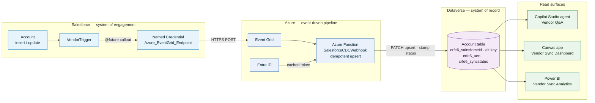
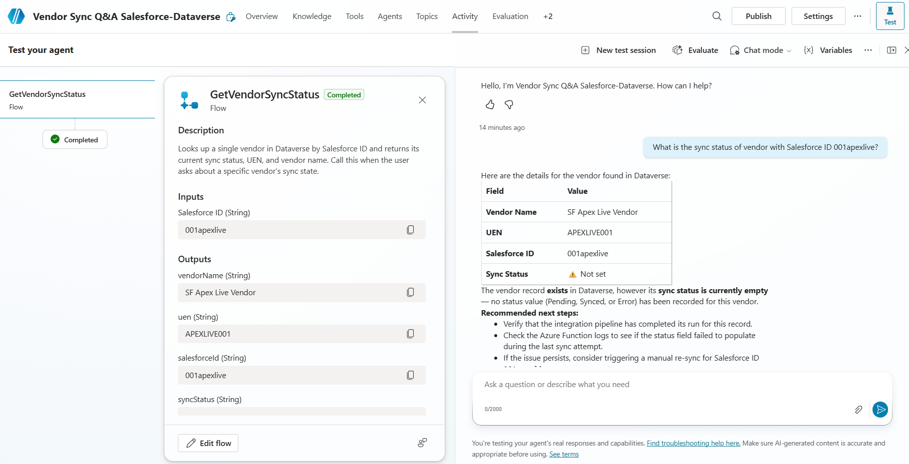
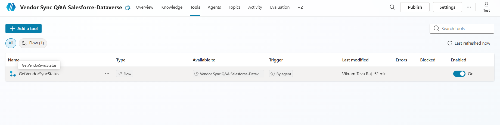
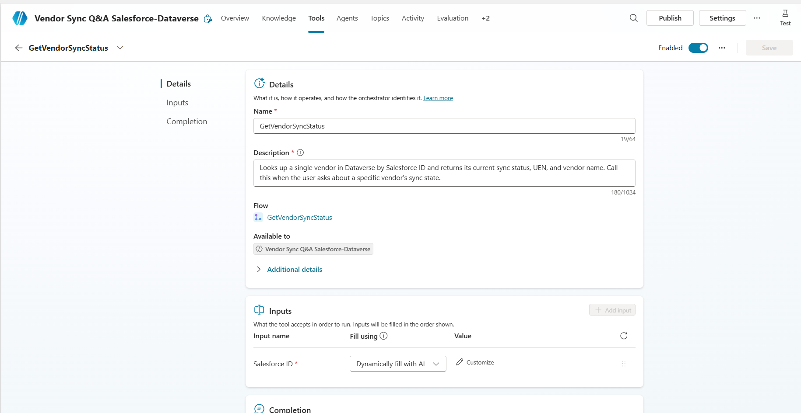

# SF → Dataverse — Vendor Onboarding Hub

A cross-platform, event-driven integration that synchronises vendor records from **Salesforce** into **Microsoft Dataverse** via an idempotent **Azure Function** middleware.

> **Repo rename note:** This repository was renamed from `universal-fabric-poc` to `sf-to-dataverse` to avoid confusion with Microsoft Fabric / OneLake. The Dataverse **solution name** (`UniversalFabric`), **publisher** (`universalfabric`), and **customization prefix** (`crfe6_`) are unchanged so the existing deployment in Vikram-Dev continues to work.

> **Status:** The **bridge's Salesforce→Dataverse sync is proven against the live Dataverse org** — [`src/azure/demo-bridge.js`](src/azure/demo-bridge.js) runs the real Function handler end-to-end and upserts a vendor row (HTTP 201 first time, 200 on re-runs; `crfe6_syncstatus` → "Synced"). Getting there required reconciling two drifts between the repo's schema and the *deployed* org: the bridge no longer writes the undeployed `crfe6_lastmodifiedbyintegration_at` column, and it resolves `crfe6_syncstatus` option values **by label** (the org uses the `705570xxx` prefix, not the repo solution's `100000xxx`). Unit tests: Azure 41/41, LWC 8/8. **Still required for hands-off production:** redeploy the Azure Function with this code and wire the Salesforce→Event Grid hop to a real endpoint (the committed named credential is a placeholder — see Local development).

> **🎥 Demo walkthrough:** A guided ~5-minute video tour of the full Salesforce → Azure → Dataverse pipeline and the three read surfaces (Copilot agent, Canvas app, Power BI) is on **[Loom](https://www.loom.com/share/aa95ded437de471fb94c87eff6f2bd07)** — narration outline in [`docs/loom-demo-script.md`](docs/loom-demo-script.md).

## Table of contents
- [Architecture](#architecture)
- [Repository layout](#repository-layout)
- [Data flow](#data-flow)
- [Copilot Studio vendor-Q&A agent](#copilot-studio-vendor-qa-agent)
- [Salesforce dashboard: Vendor Sync (LWC)](#salesforce-dashboard-vendor-sync-lwc)
- [Canvas app: Vendor Sync Dashboard](#canvas-app-vendor-sync-dashboard)
- [Power BI report: Vendor Sync Analytics](#power-bi-report-vendor-sync-analytics)
- [CI/CD](#cicd)
- [Local development](#local-development)
- [Required secrets](#required-secrets)
- [Security & compliance posture](#security--compliance-posture)
- [Further reading](#further-reading)

## Architecture



## Repository layout

```
.
├── .github/
│   ├── workflows/
│   │   ├── sf-to-dataverse-ci.yml          # Per-platform CI with path filters
│   │   └── dependency-review.yml         # Supply-chain scanning
│   ├── CODEOWNERS                        # Auto-reviewer assignment
│   └── PULL_REQUEST_TEMPLATE.md          # PR checklist
├── config/
│   └── project-scratch-def.json          # Salesforce scratch org definition
├── docs/
│   ├── governance/branch-protection.md   # main branch SOP
│   ├── infrastructure/dataverse_schema_mapping.md
│   └── security/incident-reports/        # PII / credential incident log
├── sfdx-project.json                     # Salesforce DX project
├── src/
│   ├── azure/                            # Azure Functions Node.js v4
│   │   ├── src/
│   │   │   ├── functions/SalesforceCDCWebhook.js   # Event Grid trigger
│   │   │   └── sync/dataverseSync.js               # Pure sync logic
│   │   ├── test/dataverseSync.test.js              # Jest unit tests (+ SalesforceCDCWebhook, telemetry)
│   │   ├── host.json
│   │   ├── local.settings.json          # gitignored
│   │   └── package.json                  # axios, axios-retry, @azure/identity
│   ├── salesforce/force-app/main/default/
│   │   ├── triggers/VendorTrigger.trigger          # after insert/update
│   │   ├── classes/VendorTriggerHandler.cls        # @future(callout=true)
│   │   ├── classes/VendorTriggerHandlerTest.cls    # HttpCalloutMock tests
│   │   ├── classes/VendorSyncStatusController.cls  # @AuraEnabled read API (with sharing)
│   │   ├── classes/VendorSyncStatusControllerTest.cls
│   │   ├── lwc/vendorSyncDashboard/                 # in-Salesforce sync dashboard (gallery + failed-sync tile)
│   │   ├── objects/Account/fields/UEN__c.field-meta.xml
│   │   ├── objects/Account/fields/Sync_Status__c.field-meta.xml  # picklist: Pending/Synced/Error
│   │   └── namedCredentials/Azure_EventGrid_Endpoint.namedCredential-meta.xml
│   └── powerplatform/
│       ├── sf-to-dataverse/                      # Dataverse solution (unpacked)
│       │   ├── Entities/Account/Entity.xml      # crfe6_salesforceid, crfe6_uen, crfe6_syncstatus (option set)
│       │   ├── Workflows/                        # Power Automate flow definitions
│       │   │   ├── crfe6_vendor-onboarding-approval-*.clientdata.json
│       │   │   └── crfe6_get-vendor-sync-status-*.clientdata.json   # Copilot Studio action
│       │   └── Other/                            # Solution.xml, customizations.xml
│       ├── plugins/                              # C# plugins (net48) + xUnit tests
│       ├── flows/                                # Source-of-truth Power Automate flow JSON
│       │   ├── crfe6_vendor-onboarding-approval.json
│       │   └── crfe6_get-vendor-sync-status.json # Agent-callable: GetVendorSyncStatus action
│       └── copilot-studio/
│           └── actions/get-vendor-sync-status.openapi.json   # OpenAPI 2.0 action spec
└── test/                                  # Local testing harness for the function
```

## Data flow

1. **Salesforce** — A user creates or updates an Account whose record type maps to "Vendor".
2. **`VendorTrigger`** fires (after insert / after update). On update, it diffs the three synced fields (`Name`, `UEN__c`, `CurrencyIsoCode`) and skips the callout entirely if none changed — saving governor quota.
3. **`VendorTriggerHandler.sendVendorsToAzure`** runs as `@future(callout=true)`. Per-transaction recursion guard prevents duplicate sends. Issues an HTTP POST to the Named Credential `Azure_EventGrid_Endpoint` with an Event Grid–shaped payload.
4. **Azure Event Grid** delivers the event to the `SalesforceCDCWebhook` Function.
5. **Azure Function (the bridge)** — Module-scoped `ClientSecretCredential` keeps the Entra ID token cache warm across invocations. Strips trailing slash from `DATAVERSE_ENV_URL`, looks up the currency ID via `$filter`, then PATCHes the Account by alternate key `crfe6_salesforceid` (idempotent: HTTP 201 on first sync, 200 on subsequent updates of the same row). It stamps `crfe6_syncstatus` with the value **resolved by label** from the target org's option-set metadata (cached at module scope) — so it is correct regardless of the org's option-value prefix (e.g. `705570001` for "Synced" in the deployed org vs. `100000001` in the repo solution). On a persistent failure it makes a best-effort, update-only (`If-Match: *`) write of the resolved "Error" value and rethrows, so the read side sees the real state and a later retry flips it back to Synced. It does **not** write `crfe6_lastmodifiedbyintegration_at` / `crfe6_sync_notes` — those columns are not deployed on the Account table in the target org, and the read side falls back to `createdon`. DELETE change events are skipped. `axios-retry` handles transient 429/5xx/network failures.
6. **Dataverse** — The Account row is upserted with `name`, `crfe6_uen`, and `crfe6_syncstatus`. The `crfe6_salesforceid` column has a unique alternate-key index, so concurrent PATCHes for the same Salesforce ID converge to a single row.

## Copilot Studio vendor-Q&A agent

The read side of the pipeline. An operations analyst (or a portfolio reviewer on the demo website) asks the agent for the sync state of a vendor, and it answers by calling the `crfe6_get-vendor-sync-status` Power Automate flow against Dataverse.

| Component | Where | What it does |
|---|---|---|
| Agent (browser-authored) | `copilotstudio.microsoft.com` | Instructions, topics, channel config. **Not in git** — see [`docs/copilot-studio-runbook.md`](docs/copilot-studio-runbook.md) for the ~30 min recipe. |
| Action (flow) | [`src/powerplatform/flows/crfe6_get-vendor-sync-status.json`](src/powerplatform/flows/crfe6_get-vendor-sync-status.json) | Power Automate flow the agent invokes. Resolves the vendor by the `crfe6_salesforceid` alternate key via **List rows + `$filter`** (the Dataverse "Get a row by ID" action resolves only the primary-key GUID, not alternate keys). Returns a structured payload (`found`, `vendorName`, `uen`, `syncStatus`, `lastSyncAttempt`) or a `NotSynced` fallback. |
| Action (connector) | [`src/powerplatform/copilot-studio/actions/get-vendor-sync-status.openapi.json`](src/powerplatform/copilot-studio/actions/get-vendor-sync-status.openapi.json) | OpenAPI 2.0 spec for the optional connector-backed variant (single-vendor lookup + find-by-status). |
| Schema | `crfe6_syncstatus` in [`Entities/account/Entity.xml`](src/powerplatform/sf-to-dataverse/Entities/account/Entity.xml) | Option set: Pending / Synced / Error. **Option-set integer values are environment-specific** — the repo solution defines `100000000–100000002`, but the deployed org uses `705570000–705570002`. The Azure Function resolves the value by label at runtime, so it stamps the correct one per org. |
| Channels | Demo website + MDA embed | Demo site for portfolio reviewers; MDA channel for the production in-app Copilot experience. See [`docs/architecture/copilot-agent.md`](docs/architecture/copilot-agent.md). |

**Why the agent definition isn't in git:** Copilot Studio stores agents as `bot`/`botcomponent` rows in Dataverse with no supported CLI/API for code-first authoring. The solution-aware artefacts (flow, schema, action spec) are in git; the agent itself is documented as a reproducible runbook. Full reasoning in [`docs/adr/0009-copilot-studio-split.md`](docs/adr/0009-copilot-studio-split.md).

### Live Preview evidence

The agent was authored in the **Vikram-Dev** Dataverse environment as **"Vendor Sync Q&A Salesforce-Dataverse"** and validated end-to-end in the Copilot Studio **Preview** panel on 2026-06-24. The screenshots below show (a) the agent answering a real vendor lookup with data returned from Dataverse, and (b) the Tools panel confirming the `GetVendorSyncStatus` flow is wired in with generative orchestration.



*Preview conversation — the agent called `GetVendorSyncStatus` for Salesforce ID `001apexlive` and returned `SF Apex Live Vendor` / UEN `APEXLIVE001`.*



*Tools panel — the Power Automate flow is registered as an action with generative orchestration enabled.*



*Tool detail — the action's configuration (name, description, input mapping) that the generative orchestrator uses to decide when to call the flow.*

> **Publishing status — honest note.** The agent is **Preview-validated, not published** to a public demo website. The tenant does not currently have a Copilot Studio user license, and no trial license was available, so the **Channels → Demo website** step in [`docs/copilot-studio-runbook.md`](docs/copilot-studio-runbook.md) could not be completed. There is **no public demo URL** for this agent yet. See the runbook's `Status` section for the blocking licence detail and the reproduction path.

## Salesforce dashboard: Vendor Sync (LWC)

The Salesforce-side read surface. Where the Copilot agent, Canvas app, and Power BI report all read the **Dataverse** `crfe6_syncstatus`, this Lightning Web Component reads the **Salesforce** `Sync_Status__c` picklist that `VendorTriggerHandler` stamps after each `@future` callout (`Synced` on a 2xx from Event Grid, `Error` on a non-2xx or `CalloutException`). It gives an ops analyst an in-CRM view of *outbound* sync health without leaving Salesforce.

| Component | Where | What it does |
|---|---|---|
| `vendorSyncDashboard` (LWC) | [`lwc/vendorSyncDashboard`](src/salesforce/force-app/main/default/lwc/vendorSyncDashboard/vendorSyncDashboard.js) | Datatable of recent vendors with a colour-coded status cell, a separate "failed syncs" tile, and a Refresh button (`refreshApex`). Exposed to App/Home pages and as a tab. Unit-tested with sfdx-lwc-jest. |
| `VendorSyncStatusController` (Apex) | [`classes/VendorSyncStatusController.cls`](src/salesforce/force-app/main/default/classes/VendorSyncStatusController.cls) | Two `@AuraEnabled(cacheable=true)` methods: `getRecentSyncedVendors` (most-recently-modified vendors) and `getFailedSyncs` (`Sync_Status__c = 'Error'` only). Both run in a **`with sharing`** class (record-level sharing); field-level `WITH SECURITY_ENFORCED` is a documented follow-up — see [Security & compliance posture](#security--compliance-posture). |
| `Sync_Status__c` (field) | [`fields/Sync_Status__c.field-meta.xml`](src/salesforce/force-app/main/default/objects/Account/fields/Sync_Status__c.field-meta.xml) | Picklist: Pending (default) / Synced / Error — the Salesforce mirror of the Dataverse `crfe6_syncstatus` option set. |

## Canvas app: Vendor Sync Dashboard

The human-dashboard view of the same sync state the Copilot Studio agent answers questions about. An operations analyst opens the app, sees a colour-coded gallery of vendors (green = Synced, amber = Pending, red = Error), filters by status, searches by name or Salesforce ID, and drills into a detail screen showing every sync field plus a Refresh button.

| Component | Where | What it does |
|---|---|---|
| App (browser-authored) | `make.powerapps.com` | Screens, controls, Power Fx formulas. **Not in git** — see [`docs/canvas-app-runbook.md`](docs/canvas-app-runbook.md) for the ~45 min recipe. |
| Schema | `crfe6_syncstatus` in [`Entities/account/Entity.xml`](src/powerplatform/sf-to-dataverse/Entities/account/Entity.xml) | The option set the app badges against (Pending / Synced / Error). Stamped by the Azure Function. |
| Solution.xml | [`Other/Solution.xml`](src/powerplatform/sf-to-dataverse/Other/Solution.xml) | Bumped to `1.2.0.0` with a placeholder marking where the CanvasApp `RootComponent` (type `300`) will be registered once the app is authored. |

**Why the app definition isn't in git:** Power Apps Canvas apps are authored in Studio; `pac canvas` (v2.8.1) can unpack/pack/validate an *existing* `.msapp` but cannot scaffold a new Dataverse-bound app headlessly — `pac canvas create` only works from a custom connector. The schema the app reads is in git; the app itself is documented as a reproducible runbook. Full reasoning in [`docs/adr/0010-canvas-app-source-format.md`](docs/adr/0010-canvas-app-source-format.md). A post-authoring hardening path (`pac canvas unpack` → `.pa/yaml` source) is documented in the runbook.

> **Authoring status — built.** The dashboard is live in Power Apps Studio against Dataverse: a vendors-only gallery (the 22 seeded vendors) with each row's **Sync Status** rendered in its colour (green / amber / red), a **summary header** (Synced 15 / Pending 3 / Error 4 counts), and a **status filter** dropdown — validated in Play/Preview mode. Built as a **Tablet** Canvas app named `Vendor Sync Dashboard`. Not yet published or added to the solution (runbook steps 7–8), so it's demoed from Studio Preview. The app definition stays out of git per ADR 0010 (browser-authored `.msapp`); the schema it reads is in the repo.

## Power BI report: Vendor Sync Analytics

The analytics/exec read surface — the same vendor sync state surfaced by the Copilot agent and (per the Canvas app runbook) the dashboard, now as aggregated metrics for an executive or analyst. Connect Power BI Desktop to Dataverse via the connector, derive friendly status labels, and build Overview / Sync Health / Vendor Detail pages with DAX measures over `crfe6_syncstatus`.

| Component | Where | What it does |
|---|---|---|
| Report (Desktop-authored) | Power BI Desktop → Service | Pages, visuals, DAX measures. **Not in git** — see [`docs/powerbi-report-runbook.md`](docs/powerbi-report-runbook.md) for the ~60 min recipe (includes exact DAX and Power Query M). |
| Schema | `crfe6_syncstatus` in [`Entities/account/Entity.xml`](src/powerplatform/sf-to-dataverse/Entities/account/Entity.xml) | The option set the report aggregates over (Pending / Synced / Error). Stamped by the Azure Function. |
| Solution.xml | Unchanged | Power BI reports are not Dataverse solution components, so nothing is registered here for this deliverable. |

**Why the `.pbix` isn't in git:** a `.pbix` is an opaque proprietary binary — not diff-reviewable, not regenerable headlessly. The schema the report reads is in git; the report itself is documented as a reproducible runbook with the exact DAX measures (`Vendors Total`, `Sync Rate %`, `Vendors in Error`, `Avg Sync Latency`) and Power Query M transforms. Full reasoning in [`docs/adr/0011-powerbi-report-format.md`](docs/adr/0011-powerbi-report-format.md). A post-authoring hardening path (XMLA endpoint + Tabular Editor → TMDL model source) is documented in the runbook.

> **Authoring status — built (Overview page).** The report's **Overview** page is live against Dataverse: KPI cards (Total Vendors, Sync Rate %, Vendors in Error) plus a colour-coded sync-status donut, driven by the DAX measures over the seeded data (**15 Synced / 3 Pending / 4 Error** across 22 vendors). Saved as `Vendor Sync Analytics.pbix` and demoed from Power BI Desktop. The **Sync Health** and **Vendor Detail** pages (runbook steps 5–6) are documented but not yet built, and the report is **not published to the Power BI Service** (no Pro/publish licence — same constraint as the Copilot agent), so it's demoed from Desktop. The `.pbix` stays out of git per ADR 0011.

## CI/CD

All changes go through pull requests. CI is split by platform so unrelated edits don't burn runner minutes or secrets.

| Job | Trigger path | What it does |
|---|---|---|
| `Detect Changed Platforms` | always | `dorny/paths-filter` decides which downstream jobs to run |
| `Salesforce DX Dry-Run & Tests` | `src/salesforce/**`, scratch-def, sfdx-project | **When `SFDX_AUTH_URL` is set:** creates a 1-day scratch org from the Dev Hub, deploys source, runs `RunLocalTests`, always deletes the scratch org. **When it's absent: skips gracefully** (a `::notice::`, not a failure) — mirroring the Power Platform job. The LWC Jest job is then the active Salesforce gate, and Apex is validated locally in a scratch org on demand (`sf project deploy start --test-level RunLocalTests` against a scratch org). |
| `Power Platform PAC CLI Validation` | `src/powerplatform/**` | Packs the solution, runs `who-am-i` auth check, runs Solution Checker, uploads the packed `.zip` as an artifact |
| `Azure Function Unit Tests` | `src/azure/**` | `npm ci` + `npm test` (Jest with coverage — happy path, `crfe6_syncstatus` Synced/Error stamping, last-sync timestamp, OData-injection encoding, config + `DATAVERSE_APP_ID` fallback) |
| `Salesforce LWC Jest Tests` | `src/salesforce/**` | `npm ci` + `npm run test:unit` (sfdx-lwc-jest, run from repo root) for the `vendorSyncDashboard` component |
| `Scan Dependency Changes` | `src/azure/package*.json` | `npm audit --omit=dev --audit-level=low` + advisory dependency-review-action |

Workflows:
- `.github/workflows/sf-to-dataverse-ci.yml` — the per-platform CI matrix above
- `.github/workflows/dependency-review.yml` — supply-chain scan

Concurrency: each PR has a single in-flight run; pushing a new commit cancels the previous.

## Local development

### Azure Function

```bash
cd src/azure
npm install
# Start Azurite (storage emulator) in a separate terminal — required for local Event Grid
azurite --silent --location ./.azurite --debug ./.azurite/debug.log
# Set required env vars in local.settings.json (see "Required secrets" below)
npm start
```

Trigger a test event (from repo root):

```bash
bash test/trigger-local-event.sh
```

Run unit tests:

```bash
cd src/azure && npm test
```

### Live demo

Run the real Function handler against the live Dataverse env (reads the repo-root `.env`), simulating a Salesforce vendor event and reading the upserted row back:

```bash
cd src/azure && node demo-bridge.js            # sync a demo vendor; print the Dataverse row
cd src/azure && node demo-bridge.js --cleanup  # delete the demo vendor row
```

Manual dev/demo tooling only (touches a live org; not wired into CI). It exercises the same `SalesforceCDCWebhook` → `dataverseSync` path the deployed Azure Function runs.

### Salesforce

```bash
sf org login web --set-default-dev-hub
sf org create scratch -f config/project-scratch-def.json -a dev -y 30
sf project deploy start --target-org dev
```

> **Named credential is a placeholder.** [`Azure_EventGrid_Endpoint`](src/salesforce/force-app/main/default/namedCredentials/Azure_EventGrid_Endpoint.namedCredential-meta.xml) ships with a deliberately fake endpoint and `NoAuthentication` so no real URL or key is committed. Before the outbound callout will reach Azure, repoint it (per environment) at the real Event Grid topic or the Function's Event Grid webhook URL (`…/runtime/webhooks/EventGrid?functionName=SalesforceCDCWebhook&code=<system-key>`) and supply the access key — e.g. via an `aeg-sas-key` header on the named credential. Do not commit the real value.

### Power Platform

Import the unpacked solution from `src/powerplatform/sf-to-dataverse/` into a dev sandbox via `pac solution import` or the Maker Portal. The publisher prefix `crfe6_` will be created on first import.

### Seed demo data

To populate **realistic dummy Singapore vendor data** into Salesforce + Dataverse so the Copilot Studio agent, Canvas app, and Power BI report have varied, demo-worthy content (15 Synced / 3 Pending / 4 Error, across logistics, catering, construction, IT, facilities, and more), use the seed scripts under `test/seed-data/`. They are **manual dev tooling only** — not wired into CI, and they touch live orgs so they must be run by hand.

```bash
# 1. Salesforce (requires a writable target-org with UEN__c deployed):
sf apex run -f test/seed-data/seed-salesforce.apex
# 2. Dataverse (requires the four DATAVERSE_* vars in .env; installs axios + @azure/identity from src/azure):
node test/seed-data/seed-dataverse.js
```

The dataset, the two-phase seeding approach (Synced baseline, then post-hoc status-variety injection — because the Azure Function stamps `Synced` on every successful sync), and the exact run steps are documented in [`test/seed-data/README.md`](test/seed-data/README.md). **Status:** the demo dataset has been **seeded** for the walkthrough — Dataverse holds the 22 vendors (15 Synced / 3 Pending / 4 Error) that back the Canvas app and Power BI report above, and the Salesforce side was seeded into a scratch org. Scratch orgs are ephemeral, so re-run the scripts to reseed a fresh org.

## Required secrets

Set these as GitHub Actions secrets (repo → Settings → Secrets and variables → Actions):

| Secret | Used by | Purpose |
|---|---|---|
| `SFDX_AUTH_URL` | Salesforce CI (optional) | `force://` URL for the Dev Hub org. **Optional** — if unset, the Salesforce DX scratch-org job skips gracefully and Apex is validated locally; set it to enable the scratch-org deploy + Apex tests in CI. |
| `DATAVERSE_ENV_URL` | Power Platform CI + Azure Function | Target Dataverse URL (no trailing slash) |
| `DATAVERSE_APP_ID` | Power Platform CI + Azure Function | Service principal app ID. The Azure Function reads `DATAVERSE_CLIENT_ID` first and falls back to `DATAVERSE_APP_ID`, so either name works as the Function App setting (the PAC CLI steps use `DATAVERSE_APP_ID`). |
| `DATAVERSE_CLIENT_SECRET` | Power Platform CI + Azure Function | Service principal secret |
| `DATAVERSE_TENANT_ID` | Power Platform CI + Azure Function | Entra ID tenant ID |

Never commit `local.settings.json`, `.env`, or `sfdx_auth.txt`. See `docs/security/incident-reports/` for our credential-leak incident and rotation playbook.

## Security & compliance posture

- **Zero hardcoded credentials.** All auth material flows through GitHub secrets → environment variables → in-memory only.
- **Per-transaction recursion guard** in `VendorTriggerHandler` prevents runaway callouts.
- **Field-change filtering** in `VendorTrigger` skips no-op updates to conserve governor quota.
- **`with sharing`** on `VendorSyncStatusController` enforces record-level sharing on the user-facing (`@AuraEnabled`) read path that backs the LWC dashboard. Strict field-level enforcement (`WITH SECURITY_ENFORCED` / `stripInaccessible`) is a documented hardening follow-up, **not yet applied**: it requires a permission set granting the dashboard's audience read access to `UEN__c` / `Sync_Status__c`, otherwise the query throws "secure query included inaccessible field" and the dashboard fails to load.
- **URL encoding + OData injection prevention** in the Azure Function — single quotes percent-encoded after `encodeURIComponent`.
- **Idempotent upserts** by deterministic alternate key — replays are safe.
- **Redacted error logging** — Dataverse response bodies (potential PII) are never logged; only status codes.
- **`axios-retry`** handles transient 429/5xx/network failures with exponential backoff.
- **Dependency review** on every `package*.json` change — `npm audit` enforcement plus advisory GHAS scan.
- **CODEOWNERS** auto-requests the right reviewer per code area.
- **Branch protection SOP** documented in `docs/governance/branch-protection.md`.

## Further reading

- `docs/copilot-studio-runbook.md` — Step-by-step recipe to author the Copilot Studio vendor-Q&A agent in the browser (~30 min). The supporting code is in git; the agent definition is browser-only.
- `docs/canvas-app-runbook.md` — Step-by-step recipe to author the Vendor Sync Dashboard Canvas app in Power Apps Studio (~45 min). Includes the exact Power Fx formulas for the gallery filter/search, status badges, and detail screen.
- `docs/powerbi-report-runbook.md` — Step-by-step recipe to build the Vendor Sync Analytics Power BI report in Power BI Desktop (~60 min). Includes exact DAX measures, Power Query M transforms, and the three-page visual layout.
- `docs/architecture/copilot-agent.md` — Sequence and topology diagrams for the read side of the pipeline (agent → flow → Dataverse).
- `docs/architecture/canvas-app.md` — Sequence and topology diagrams for the dashboard read side (Canvas app → Dataverse, direct binding).
- `docs/architecture/powerbi-report.md` — Sequence and topology diagrams for the analytics read side (Power BI → Dataverse connector). Includes the three-read-surfaces topology.
- `docs/adr/0009-copilot-studio-split.md` — Why the Copilot agent definition isn't in git.
- `docs/adr/0010-canvas-app-source-format.md` — Why the Canvas app definition isn't in git, and the post-authoring source-extraction hardening path.
- `docs/adr/0011-powerbi-report-format.md` — Why the `.pbix` isn't in git, and the post-authoring XMLA/TOM model-extraction hardening path.
- `docs/infrastructure/dataverse_schema_mapping.md` — How to set up the Account custom columns and alternate key in a fresh Dataverse environment.
- `docs/governance/branch-protection.md` — The intended `main` branch policy and the `gh api` command to apply it.
- `docs/security/incident-reports/2026-06-20-credential-leak.md` — The `.env` leak incident and rotation playbook.