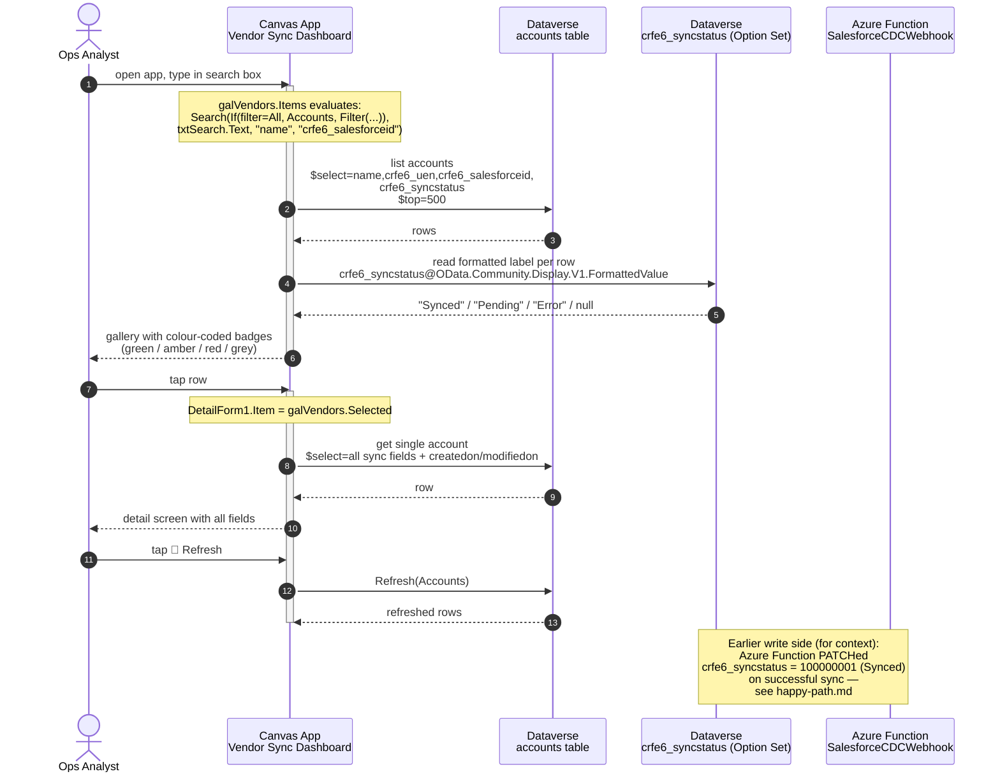
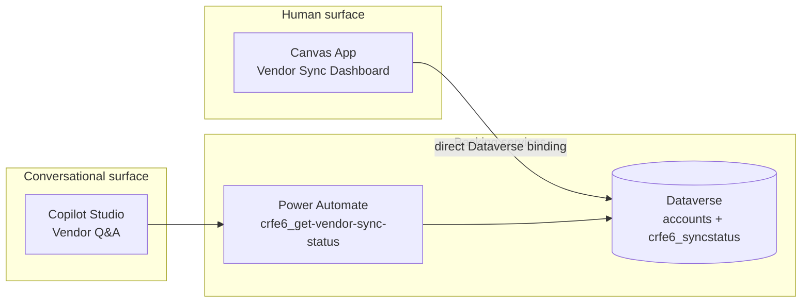

# Canvas app — Vendor Sync Dashboard (read path)

This diagram covers the **read** side of the SF → Dataverse pipeline as
experienced by a human operator: an ops analyst opens the **Vendor Sync
Dashboard** Canvas app and browses the sync state that the Azure Function
stamps into Dataverse (`crfe6_syncstatus`).

It is the human-GUI complement to the [Copilot Studio agent](./copilot-agent.md)
read path — same backing data, different surface (interactive dashboard vs
conversational).

## Sequence diagram

## Topology

The Canvas app reads Dataverse **directly** (no flow in between), unlike the
Copilot Studio agent which routes through Power Automate. This is intentional:
the dashboard is a trusted internal tool where the connection runs in the
signed-in user's context, so the extra indirection of a flow would add
latency without adding capability.

## What this means for `crfe6_syncstatus`

The dashboard is the third consumer (after the Copilot Studio agent and the
Salesforce read-back field) of the `crfe6_syncstatus` value that the Azure
Function stamps:

| Consumer | Reads `crfe6_syncstatus` from | Surface |
|---|---|---|
| Copilot Studio agent | Dataverse via Power Automate flow | Conversational |
| **Canvas app (this)** | **Dataverse directly** | **Interactive dashboard** |
| Salesforce `Sync_Status__c` | Apex-side stamp after Azure Function 2xx | Salesforce UI |

All three read the same source of truth — Dataverse `crfe6_syncstatus`,
written by the Azure Function. This is the architectural reasoning captured
in [`docs/adr/0010-canvas-app-source-format.md`](../adr/0010-canvas-app-source-format.md).
