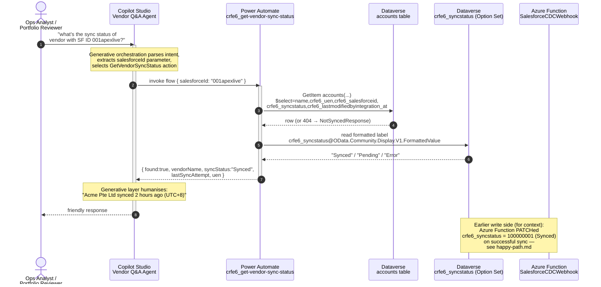
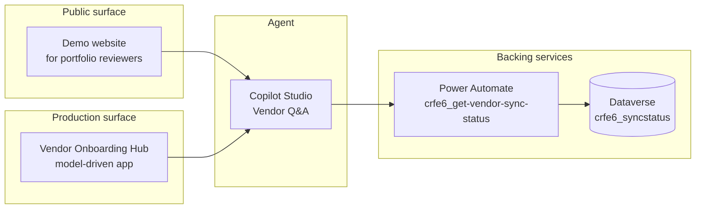

# Copilot Studio agent — read path

This diagram covers the **read** side of the SF → Dataverse pipeline: an
operations analyst or a reviewer asks the Copilot Studio agent for the
sync state of a vendor, and the agent answers by calling the
`crfe6_get-vendor-sync-status` Power Automate flow against Dataverse.

This is the complement to the [write path](happy-path.md) (Salesforce →
Azure Function → Dataverse). Together they form the full bidirectional
picture.

## Sequence diagram

## Two channels

The agent is published to two channels simultaneously:

1. **Demo website** — public URL for portfolio reviewers. One click, no
   provisioning required. Used for the screenshots in `docs/images/`.
2. **Microsoft Dynamics 365 channel** — embedded in the
   `crfe6_vendoronboardinghub` model-driven app. This is the production
   architecture: the agent inherits the signed-in user's Dataverse
   row-level security context and can act on the currently-selected
   Account record.

## What this means for `crfe6_syncstatus`

Before the agent was added, `crfe6_syncstatus` existed only conceptually
— the Salesforce-side `Sync_Status__c` was the source of truth. Adding
the agent flips that:

| Question | Before | After |
|---|---|---|
| Where does the agent read sync status? | N/A (no agent) | `crfe6_syncstatus` in Dataverse |
| Where does `crfe6_syncstatus` come from? | N/A | Azure Function stamps it on every successful PATCH (option value `100000001` = Synced) |
| Where does Salesforce's `Sync_Status__c` come from? | `VendorTriggerHandler` stamps it after a 2xx from the Azure Function | Unchanged — still stamped the same way |

Dataverse is now the **read** source of truth; Salesforce remains the
**write** source of truth. This is the architectural reasoning captured in
[`docs/adr/0009-copilot-studio-split.md`](../adr/0009-copilot-studio-split.md).
