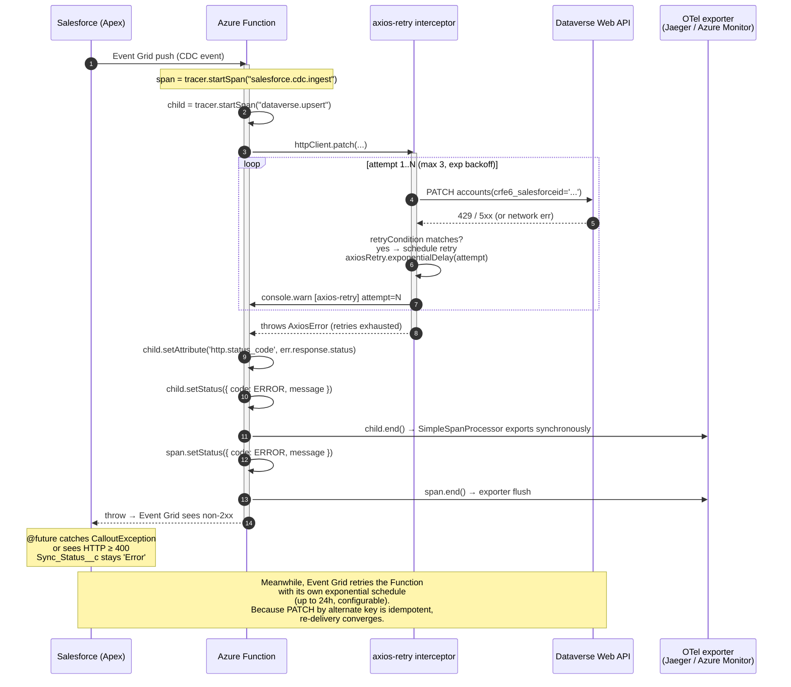

# Error & retry path

What happens when the OData PATCH to Dataverse fails with 429 (throttled) or a
5xx, and how the pipeline degrades rather than corrupts.

## Sequence diagram

## Retry layers (defence in depth)

There are three independent retry layers, each with a different blast radius:

| Layer | Mechanism | Triggered by | Backoff | Max attempts |
| --- | --- | --- | --- | --- |
| `axios-retry` (in-process) | interceptor on the global `axios` instance | 429 / 408 / 5xx / network error | exponential (1s, 2s, 4s base) | 3 |
| Azure Event Grid (broker) | built-in to the topic | Function returns non-2xx | exponential, max 24 h | configurable per subscription |
| Salesforce `Sync_Status__c` | operator-visible state | any failure that escapes the above | n/a (manual) | n/a |

`axios-retry` is the first line because it has the lowest latency and the
richest error context (HTTP status). Event Grid retries are the durable
fallback for longer outages. `Sync_Status__c` is the user-visible laggard — it
is not a retry mechanism, it is a feedback mechanism so a Salesforce admin can
see which records need attention.

## Why PATCH-by-alternate-key makes this safe

The idempotency of `PATCH accounts(crfe6_salesforceid='...')` is what makes the
multi-layer retry safe. Event Grid does not deduplicate, and `axios-retry`
replays the same PATCH on transient failure. Because the alternate key is
deterministic per Salesforce record, every replay converges to the same
Dataverse row state — no duplicate inserts, no double-stamps. See
[ADR 0007](../adr/0007-alternate-key-patch-vs-upsert.md).

## What is recorded

- **Span attributes** — `event.id`, `event.type`, `event.subject`
  (`salesforce.cdc.ingest`), `account.salesforce_id`, `http.status_code`
  (`dataverse.upsert`). PII (Account name, UEN) is never instrumented.
- **Span status** — set to `ERROR` with `err.message` on both spans when the
  PATCH throws.
- **Function logs** — `context.error` with the Dataverse status (status code
  only; the response body, which may contain PII, is never logged).
- **Salesforce** — `Sync_Status__c = 'Error'` and a debug log at
  `LoggingLevel.ERROR`.

## What is NOT retried

- 4xx other than 408 and 429 (e.g. 400 Bad Request, 401 Unauthorized, 403
  Forbidden). These are surfaced immediately — retrying them is pointless and
  hides config bugs. They land on `Sync_Status__c = 'Error'` and surface in
  the dashboard for manual triage.
- DELETE change events — the Function short-circuits with `204 skipped: true`
  before reaching the PATCH, so retries do not apply.
