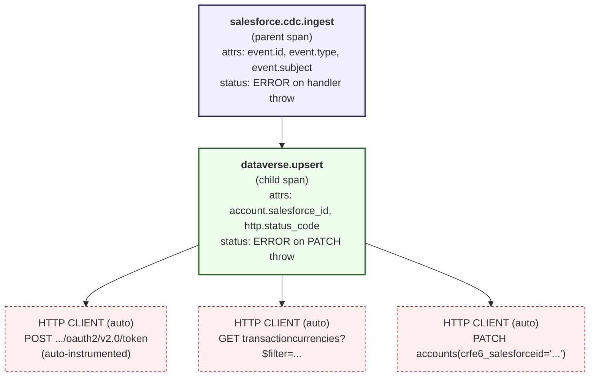

# Observability

How the SF → Dataverse integration emits, transports, and renders traces.

## Span hierarchy



Three categories of span:

1. **Application spans** — `salesforce.cdc.ingest` (parent, wraps the whole
   trigger handler) and `dataverse.upsert` (child, wraps the OData PATCH).
   These are started explicitly in `src/azure/src/functions/SalesforceCDCWebhook.js`
   and `src/azure/src/sync/dataverseSync.js`.
2. **Auto-instrumented HTTP CLIENT spans** — emitted by
   `@opentelemetry/instrumentation-http` for every outbound axios call (token
   endpoint, currency lookup, PATCH). These carry the OTel HTTP semantic
   attributes (`http.method`, `http.url`, `http.status_code`, `http.host`).
3. **Resource attributes** — attached to every span once at SDK init in
   `src/azure/src/telemetry.js`: `service.name`, `service.version`,
   `deployment.environment`.

The parent → child relationship between `salesforce.cdc.ingest` and
`dataverse.upsert` is automatic via OTel context propagation. The
`HTTP CLIENT` children hang off `dataverse.upsert` because the PATCH and the
currency GET both happen inside that span's lifetime.

## What renders in Jaeger

Opening the trace for a successful sync in Jaeger at http://localhost:16686
shows:

```
sf-to-dataverse-salesforce-cdc · 12.4ms
├── salesforce.cdc.ingest                    12.4ms
│   ├── dataverse.upsert                      9.8ms
│   │   ├── HTTP GET ...token (auto)          1.2ms  (200)
│   │   ├── HTTP GET ...transactioncurrencies 2.1ms  (200)
│   │   └── HTTP PATCH ...accounts(...)       6.3ms  (204)
```

For a failed sync, the `dataverse.upsert` and `salesforce.cdc.ingest` rows are
coloured red (status = ERROR), the PATCH child shows its status code, and the
error message is visible in the span detail panel.

## OTel environment variables

| Variable | Required | Default | Effect |
| --- | --- | --- | --- |
| `OTEL_EXPORTER_OTLP_ENDPOINT` | yes (for tracing) | unset | If unset, `src/telemetry.js` returns a no-op tracer and never starts the SDK. Set to `http://localhost:4318/v1/traces` locally, or Azure Monitor's OTLP endpoint in prod. |
| `OTEL_SERVICE_ENV` | optional | `local` | Stamped as `deployment.environment`. Use `staging` / `prod` so production traces are filterable from dev in the backend. |
| `OTEL_DEBUG` | optional | unset | Set to `1` to print the SDK start banner (endpoint + env) to stderr — useful when verifying instrumentation in CI. |

`host.json` carries `"telemetryMode": "OpenTelemetry"` so the Functions
runtime also routes its own host logs through OTel rather than the classic
App Insights SDK.

## Local viewer: Jaeger via docker-compose

`src/azure/docker-compose.otlp.yml` boots a Jaeger all-in-one container with
OTLP ingest enabled on ports 4317 (gRPC) and 4318 (HTTP), and the UI on 16686.

```bash
cd src/azure
docker compose -f docker-compose.otlp.yml up -d
# In local.settings.json set OTEL_EXPORTER_OTLP_ENDPOINT=http://localhost:4318/v1/traces
npm start
# Trigger an event, then open http://localhost:16686
# Pick service: sf-to-dataverse-salesforce-cdc
```

Tear down with `docker compose -f docker-compose.otlp.yml down`.

## PII allowlist

Only the Salesforce system ID (`event.id`, `event.subject`,
`account.salesforce_id`) is ever instrumented. Account name, UEN, currency,
and any field that could be PII stay in the OData request body — never in
telemetry. The test suite at `src/azure/test/telemetry.test.js` asserts this
allowlist statically. See [ADR 0006](../adr/0006-simplespanprocessor-over-batchspanprocessor.md)
for the processor choice and [ADR 0004](../adr/0004-opentelemetry-over-application-insights-sdk.md)
for the SDK choice.
