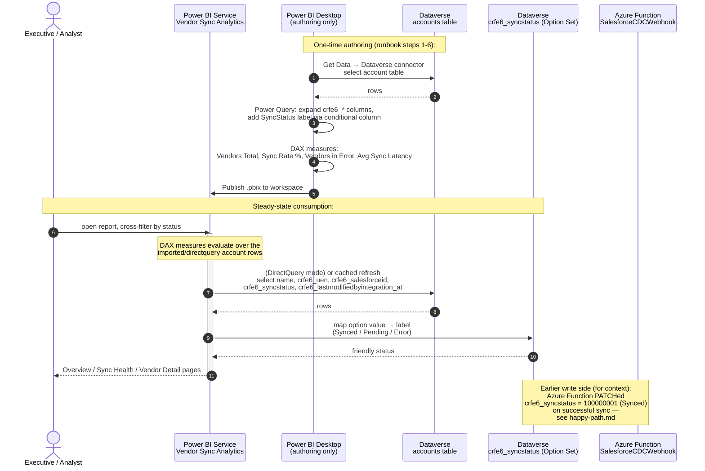
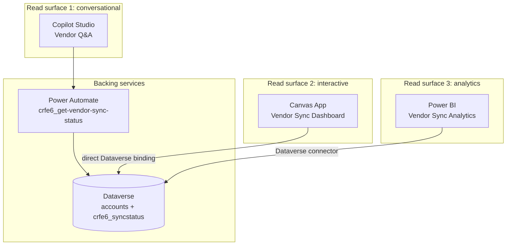

# Power BI report — Vendor Sync Analytics (read path)

This diagram covers the **read** side of the SF → Dataverse pipeline as
experienced by an executive or analyst: they open the **Vendor Sync
Analytics** Power BI report and consume aggregated sync-state metrics
derived from the `crfe6_syncstatus` field that the Azure Function stamps
into Dataverse.

It is the analytics complement to the [Copilot Studio agent](./copilot-agent.md)
(conversational) and the [Canvas app](./canvas-app.md) (interactive) —
same backing data, different surface (aggregated/exec view).

## Sequence diagram

## Topology — three read surfaces, one source of truth

All three read surfaces consume the same `crfe6_syncstatus` value written
by the Azure Function. They differ in surface and access pattern:

| Surface | Audience | Access pattern | Latency |
|---|---|---|---|
| Copilot Studio agent | Ops analyst (conversational) | Per-query, via Power Automate flow | ~1-2 s per lookup |
| Canvas app dashboard | Ops analyst (interactive) | Direct Dataverse binding, on-demand | sub-second |
| **Power BI report (this)** | **Executive / analyst (aggregated)** | **Dataverse connector, scheduled refresh or DirectQuery** | **minutes (import) to seconds (DirectQuery)** |

## What this means for `crfe6_syncstatus`

The report is the third consumer of the `crfe6_syncstatus` value:

| Consumer | Reads `crfe6_syncstatus` from | Surface |
|---|---|---|
| Copilot Studio agent | Dataverse via Power Automate flow | Conversational |
| Canvas app | Dataverse directly | Interactive dashboard |
| **Power BI report (this)** | **Dataverse via the Dataverse connector** | **Aggregated analytics** |

All three read the same source of truth — Dataverse `crfe6_syncstatus`,
written by the Azure Function. This is the architectural reasoning captured
in [`docs/adr/0011-powerbi-report-format.md`](../adr/0011-powerbi-report-format.md).
