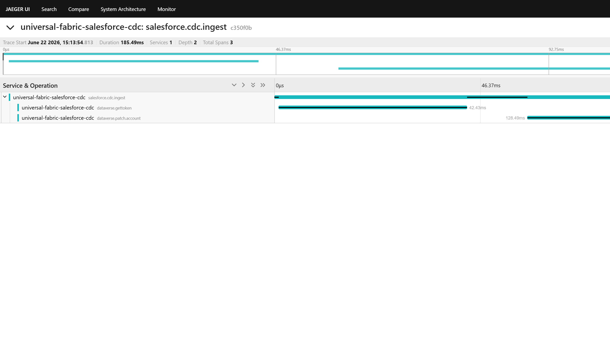

# SF → Dataverse — Azure Function middleware

Event-driven middleware that bridges Salesforce Change Data Capture events
and the Power Platform Dataverse `Account` table. Triggered by Azure Event Grid,
the function upserts vendor state into Dataverse via the OData v9.2 Web API
using the `crfe6_salesforceid` alternate key, so replays are idempotent.

## Quick links

| What                          | Where                                                 |
| ----------------------------- | ----------------------------------------------------- |
| Function source               | `src/functions/SalesforceCDCWebhook.js`               |
| Sync core (pure, unit-tested) | `src/sync/dataverseSync.js`                           |
| Jest tests                    | `test/*.test.js`                                      |
| Local settings template       | `local.settings.example.json` (copy → `local.settings.json`) |
| OTel bootstrap                | `src/telemetry.js`                                    |
| Jaeger compose                | `docker-compose.otlp.yml`                             |
| Host config                   | `host.json`                                           |

## Local run

```powershell
npm install
Copy-Item local.settings.example.json local.settings.json
# Edit local.settings.json with your Dataverse app registration + secret
docker compose -f docker-compose.otlp.yml up -d   # optional: local Jaeger
npm start
```

`func start` watches for `local.settings.json` (gitignored). If you want
OpenTelemetry spans exported, set `OTEL_EXPORTER_OTLP_ENDPOINT` in
`local.settings.json` to `http://localhost:4318/v1/traces` (the Jaeger
container's OTLP HTTP port). With it unset, telemetry is a no-op — the
function still runs, just without spans.

## Tests

```bash
npm test    # runs Jest with --ci --coverage
```

Coverage gate: 80% on branches/functions/lines/statements globally. The
existing 23 tests cover the credential cache, axios-retry config, payload
validation, currency-bind resolution, idempotency, URL-encoding hygiene,
and error propagation. The telemetry module adds 10 more covering span
lifecycle, error-status path, and PII hygiene.

## Observability

### What OpenTelemetry is

OpenTelemetry (OTel) is the CNCF-owned, vendor-neutral standard for
emitting traces, metrics, and logs from application code. Instead of
hard-coding to a specific backend (Application Insights, Datadog, New
Relic, Honeycomb, …), the application emits OTLP-formatted telemetry, and
**any OTLP-capable collector or backend** can ingest it.

### Why we use it over the Application Insights SDK

The Application Insights SDK is being deprecated in favour of OTel:

- Microsoft's recommended path for new Azure Functions is `telemetryMode: OpenTelemetry`
  in `host.json` plus an OTel SDK in the worker. (See
  [Use OpenTelemetry with Azure Functions](https://learn.microsoft.com/azure/azure-functions/opentelemetry-howto).)
- The same SDK + exporter works locally against Jaeger, in dev against a
  self-hosted collector, and in prod against Azure Monitor's OTLP endpoint —
  no code changes between environments.
- OTel auto-instrumentation captures outbound HTTP/axios calls for free
  (every Dataverse PATCH shows up as a child span of the trigger span,
  correlated via trace context).

### How to view traces locally

1. Start Jaeger all-in-one:

   ```bash
   docker compose -f docker-compose.otlp.yml up
   ```

2. In `local.settings.json` set:

   ```json
   "OTEL_EXPORTER_OTLP_ENDPOINT": "http://localhost:4318/v1/traces",
   "OTEL_SERVICE_ENV": "local"
   ```

3. `func start` and invoke the function (post an Event Grid event or hit the
   Azurite-backed local trigger).

4. Open <http://localhost:16686>, pick service
   `sf-to-dataverse-salesforce-cdc`, and inspect the trace tree.

   Tip: `scripts/smoke-trace.js` emits a representative happy-path +
   error-path trace pair without needing the Functions runtime or live
   Dataverse credentials:

   ```bash
   OTEL_EXPORTER_OTLP_ENDPOINT=http://localhost:4318/v1/traces \
   OTEL_SERVICE_ENV=local-smoke \
   node scripts/smoke-trace.js
   ```

### Smoke trace example

The screenshot below is a real capture from the Jaeger UI after running
`scripts/smoke-trace.js` against the local `docker-compose.otlp.yml`
container. It shows a single `salesforce.cdc.ingest` root span (the
function-level trigger span) with two child spans — `dataverse.gettoken`
(the simulated `ClientSecretCredential` token acquisition) and
`dataverse.patch.account` (the OData PATCH to the Dataverse alternate-key
endpoint). Total wall-clock duration ~185 ms, depth 2, 3 spans — exactly
the shape production traffic produces when a Salesforce CDC event flows
through the function.



### Span hierarchy

```
salesforce.cdc.ingest              (parent — wraps the whole trigger handler)
├── attributes: event.id, event.type, event.subject
├── on error: status=ERROR, message=<error.message>
├── dataverse.gettoken             (child — wraps ClientSecretCredential)
│   └── attributes: dataverse.tenant, dataverse.client_id
└── dataverse.patch.account        (child — wraps the OData PATCH by alternate key)
    ├── attributes: http.method, http.url, http.status_code
    └── on error: status=ERROR, recorded exception
```

Plus auto-instrumented `HTTP CLIENT` spans from `@opentelemetry/instrumentation-http`
for every outbound call (Dataverse token endpoint, currency lookup, PATCH).
Those auto-spans carry the standard OTel HTTP semantic attributes
(`http.method`, `http.url`, `http.status_code`, `http.host`, …).

### PII hygiene

Only the Salesforce system ID (`event.id`, `event.subject`,
`account.salesforce_id`) ever lands in span attributes. **Account name and
UEN are never instrumented** — they stay in the Dataverse payload body,
never in telemetry. The test suite asserts this allowlist statically.

### Span processor choice

We use **`SimpleSpanProcessor`** (not `BatchSpanProcessor`). The reason is
serverless reality: the Azure Functions worker can be frozen between
invocations and shut down with no notice. A batched exporter accumulates
spans and flushes them on a timer (default 5 s) or queue-pressure — which
means in a low-traffic function you routinely lose the last batch of every
cold-start lifecycle. `SimpleSpanProcessor` exports synchronously on every
`span.end()`, trading a small per-span HTTP cost for guaranteed delivery.
That is the correct trade-off for a serverless function with sub-1-QPS
traffic.

### Resource attributes

Every span carries these identifying attributes (set once at SDK init in
`src/telemetry.js`):

- `service.name = "sf-to-dataverse-salesforce-cdc"`
- `service.version = "1.0.0"`
- `deployment.environment = process.env.OTEL_SERVICE_ENV || "local"`

Set `OTEL_SERVICE_ENV=prod` (or `staging`) in the Function App's app
settings so production traces are filterable from dev in the backend.

### Graceful degradation

`src/telemetry.js` is a **no-op when `OTEL_EXPORTER_OTLP_ENDPOINT` is unset**.
It returns the global tracer (which produces non-recording spans) and never
starts the SDK. This means:

- `npm test` does not require a collector to be running.
- A reviewer running `func start` for the first time without touching
  `local.settings.json` will see no trace export attempts in the logs.
- Production rollout can be done by simply setting the env var — no code
  changes, no redeploy of instrumentation.
